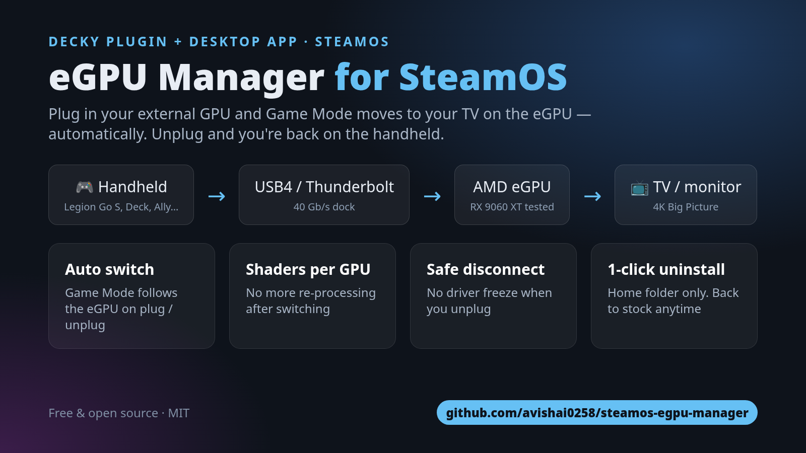

# eGPU Manager for SteamOS

**Plug-and-play external GPU for SteamOS handhelds.** Plug in your eGPU and Game Mode, Big Picture and your games run on it, on your TV or monitor. Unplug it and you're back on the handheld screen. Each GPU keeps its own shaders, so switching never rebuilds them.

Comes as a **Decky plugin** (Game Mode) and a **Desktop Mode app**, with a one-click installer and a one-click uninstaller.

<p align="center"></p>

<!-- SCREENSHOTS -->

> ⚠️ **Early release, tested on one setup so far** (see [Tested hardware](#tested-hardware)). It only changes files in your home folder and can be fully removed with **Uninstall**. If it works for you, please press **It works: share my hardware** in the plugin, so others know what works.

## Features

- **Game Mode on the eGPU automatically.** With an eGPU + monitor attached, Big Picture, games and the display all run on the eGPU. The handheld's own screen switches off. You can turn auto-switching off and use the **Switch** button instead.
- **One-button switching** between the eGPU and the handheld screen, without unplugging anything.
- **Separate shaders per GPU.** Steam's shader cache is kept per GPU and swapped in before Steam starts, so switching doesn't trigger "Processing Vulkan shaders" again. The **Shaders** page lists every game with its size per GPU (`iGPU: 5.4 GB · eGPU: N/A yet`) and lets you delete them per GPU.
- **Safe disconnect.** Moves Game Mode to the built-in GPU and releases the card in software, then tells you when it's safe to unplug. On today's Linux, pulling the cable while the GPU is in use can freeze the driver until a reboot.
- **Smooth Desktop Mode.** When the eGPU drives the monitor, KDE itself renders on the eGPU, instead of copying every frame over USB4.
- **Status at a glance:** which eGPU, how it's connected (USB4 / Thunderbolt and its speed, dock chip, PCIe link), and which monitor is attached.
- **Check setup** walks through port → dock → cable speed → GPU → driver → monitor, and fixes what it can (for example, approving the USB4 dock).
- **Survives SteamOS updates.** Everything lives in your home folder. The read-only system partition is never touched.

## Requirements

- SteamOS 3.7 or newer (tested on 3.9.5).
- A handheld with USB4 / Thunderbolt (or OCuLink).
- An **AMD** graphics card in the dock. NVIDIA isn't supported on SteamOS.
- The monitor or TV plugged into the **graphics card**, not the handheld.
- [Decky Loader](https://decky.xyz) for the Game Mode plugin. It's optional: without it you still get automatic Game Mode switching and the Desktop app.
- A sudo password. If you never set one, open Konsole and run `passwd`.

## Install

1. Switch to **Desktop Mode** and plug in the eGPU (dock powered on, monitor connected to the graphics card).
2. Download **`eGPU-Manager.zip`** from [Releases](../../releases/latest) and extract it.
3. Double-click **First-time setup**. You'll be asked for your password once.
4. Go back to **Game Mode**. Big Picture opens on the eGPU.
5. The plugin is in the **Quick Access menu → Decky → eGPU Manager**:
   - Handheld: the `…` button.
   - Xbox controller: **Xbox + A**.
   - Keyboard: **Ctrl + 2**.

The Desktop app is in the application menu and on the desktop, as **eGPU Manager**.

## Uninstall: undo everything

Use any of these:
- Double-click **Uninstall** in the extracted folder.
- In the Desktop app, choose **Uninstall eGPU Manager**.
- Run `~/.local/share/egpu-auto/uninstall.sh` in Konsole. Add `--purge` to also delete the other GPU's saved shaders and the settings.

The uninstaller:
- Closes Steam and puts its shader cache back in the normal folder (your current shaders are kept).
- Restores the built-in screen.
- Removes the Game Mode and Desktop Mode integration, the Desktop app and the Decky plugin (one password prompt).

From the next start of Game Mode, SteamOS behaves exactly as stock.

## Tested hardware

| Handheld | SteamOS | eGPU | Dock / connection | Result |
|---|---|---|---|---|
| Lenovo Legion Go S (Z1 Extreme) | 3.9.5 | AMD Radeon RX 9060 XT | AOOSTAR AG02 (ASMedia ASM246x), USB4 40 Gb/s | ✅ Works |

**Got it working on different hardware?** Press **It works: share my hardware** (plugin → Settings, or the Desktop app). It opens a pre-filled GitHub post with your handheld, GPU, dock and a short log, and no serial numbers. You review it before posting, and it gets added to this table.

**Something wrong?** Press **Report a problem**. It does the same, with the log attached.

## Known issues & tips

- **Big Picture looks low-res on a 4K TV:** Steam picks its own resolution on external displays. Set it once in **Settings → Display → Resolution**. For games, set **Properties → General → Game Resolution → Native**.
- **The eGPU can drop off the bus** under some loads (`amdgpu: device lost from bus` in the log). This is a driver or USB4-link issue, not this tool. If it happens often, check the dock's power supply and use a short, certified 40 Gb/s cable. The plugin detects it and offers a reboot.
- **Never force-restart while Steam shows "Installing update".** That breaks Steam's own files, and the next start takes several minutes while Steam repairs itself.
- If a game won't start after you've been switching GPUs, look for a clash between other launch-option plugins first: several Decky plugins rewrite games' launch options.

## Command line

```
~/.local/share/egpu-auto/egpu-ctl status          # what is connected and how
~/.local/share/egpu-auto/egpu-ctl switch egpu|igpu
~/.local/share/egpu-auto/egpu-ctl disconnect      # safe disconnect (asks for your password)
~/.local/share/egpu-auto/egpu-ctl connect
~/.local/share/egpu-auto/egpu-ctl set AUTO_SWITCH|SHADER_SWAP|USE_EGPU on|off
~/.local/share/egpu-auto/egpu-ctl doctor          # check the whole setup
~/.local/share/egpu-auto/egpu-ctl shader-games    # shaders per game and GPU (JSON)
~/.local/share/egpu-auto/egpu-ctl report          # hardware report for sharing
journalctl --user -b | grep egpu-auto             # logs
```

Settings are in `~/.config/egpu-auto.conf` (`USE_EGPU`, `AUTO_SWITCH`, `SHADER_SWAP`, `WAIT_SECS`).

## How it works

- **Game Mode.** A systemd user drop-in wraps `gamescope-session`. At start it checks for an eGPU with a monitor. If there is one, it runs gamescope on that card (`--prefer-vk-device`) and points games at it (`MESA_VK_DEVICE_SELECT`, `DRI_PRIME=pci-…`).
- **Hotplug.** A udev watcher restarts Game Mode on the right GPU when the eGPU or its monitor is plugged in or unplugged. A TV going into standby isn't treated as an unplug.
- **Built-in screen.** gamescope on the eGPU doesn't drive the handheld panel, so the console framebuffer would keep it lit with a black screen. The Decky backend (root) holds the iGPU's DRM master and switches its outputs off while Game Mode runs on the eGPU, then releases it.
- **Shaders.** `<library>/steamapps/shadercache` becomes a symlink to `shadercache.<gpu>`, and the `ShaderCacheManager` block of Steam's `config.vdf` is saved and restored per GPU (backup: `config.vdf.egpu-bak`). The swap only happens while Steam is closed.
  - Shaders from before setup were built on both GPUs, so they're labeled iGPU and hard-linked into the new GPU profile, which costs no extra space. Mesa keys every entry by GPU, so mixed caches are safe.
- **Desktop Mode.** A Plasma env script sets `KWIN_DRM_DEVICES` so KWin renders on the eGPU when it drives the monitor, and sets an explicit `DRI_PRIME` so apps follow.
- **Root actions.** Removing or rescanning the PCI device, approving the dock and installing the plugin go through `pkexec` in Desktop Mode, or through the Decky backend, which already runs as root.

## Building

```bash
cd decky && pnpm install && ./package.sh   # -> decky/out/eGPU-Manager.zip
```

## License

MIT
